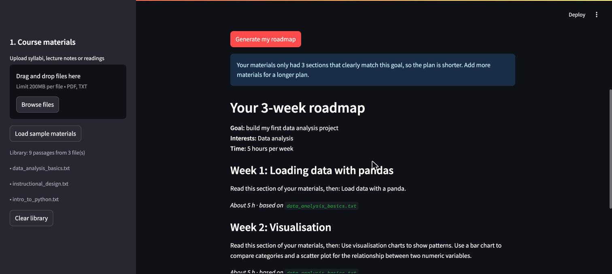
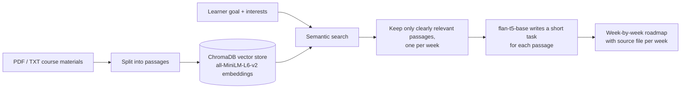

# RoadmapGeneratorAI

**Turn your own course materials into a week-by-week study plan, with a source for every step.**

RoadmapGeneratorAI is a small retrieval-augmented generation (RAG) app. A learner uploads syllabi, lecture notes or readings, describes a goal, and gets a personalised plan. Each week is based on one passage from the learner's own files and says which file it came from, so the learner (or a teacher) can always check where a recommendation comes from.



## Why this project

Generic AI study plans often sound confident but are not connected to what a course actually teaches. In instructional design terms, they are not *aligned* with the course content. This app tests a simple idea: if every step of a plan is grounded in the learner's own materials and shows its source, the plan stays relevant and the learner stays in control of their learning.

It started as my final project for **CEIT 490: Developing Educational Applications Using Large Language Models** at Middle East Technical University (2025). In 2026 I rebuilt it so that it runs end to end, explains its sources and is covered by tests.

## How it works



1. **Ingest** (`roadmap/ingest.py`): files are read (PDF via `pypdf`), split into passages of about 450 characters, embedded with `all-MiniLM-L6-v2` and stored in a persistent ChromaDB collection. Re-uploading a file replaces its old passages instead of duplicating them.
2. **Retrieve** (`MaterialStore.search`): the learner's goal and interests become a search query. Passages are ranked by cosine distance.
3. **Select** (`RoadmapGenerator.pick_chunks`): only passages close to the best match are kept, so unrelated material does not end up in the plan. If the materials only cover three relevant sections, the plan has three weeks and the app says so, instead of padding the plan.
4. **Generate** (`RoadmapGenerator.write_task`): for each selected passage, the local model `google/flan-t5-base` writes a short practice task based only on that passage.

## Design decisions

- **Small steps instead of one long prompt.** Small open models are poor at writing a long, structured plan in one go: in my tests, `flan-t5-base` repeated itself or stopped half-way. Asking it one short question per passage gives clear, concrete tasks. I compared four prompt styles, and a summary-style instruction ("Summarize what a student should do to learn this: …") gave the most useful output, so the app uses that.
- **Transparency.** Every week names its source file. This makes the plan checkable, which matters for learner trust and for teachers who want to use it.
- **Honest output.** The app prefers a shorter, relevant plan over a longer one filled with unrelated material.
- **Free and local.** Everything runs on a laptop without an API key, so students and schools can try it at no cost and without sending their materials to a third party.

## Run it

Requires Python 3.10+.

```bash
git clone https://github.com/tugceunlu/RoadmapGeneratorAI.git
cd RoadmapGeneratorAI
python -m venv .venv && source .venv/bin/activate
pip install -r requirements.txt
streamlit run app.py
```

In the sidebar, click **Load sample materials** (three short course-note files in `sample_materials/`) or upload your own PDF/TXT files. Then describe your goal and click **Generate my roadmap**. The first run downloads the models (about 1 GB).

## Tests

```bash
pytest
```

The tests check file reading and splitting, that re-adding a file does not create duplicates, that search finds the right file, and that the roadmap has one week per passage with its source. The language model is replaced by a stub so the tests run in a few seconds.

## Project structure

```
app.py                  Streamlit interface
roadmap/
  ingest.py             reading, splitting, storing and searching materials
  generate.py           passage selection and task writing
sample_materials/       example course notes for a quick demo
tests/                  pytest tests
docs/screenshot.jpg
```

## Limitations and next steps

- `flan-t5-base` is small, so tasks are short and sometimes simple. An option to use a larger model would improve the wording.
- Relevance is judged by embedding similarity only. A teacher-defined topic order would make plans follow the course sequence more closely.
- The app has not yet been evaluated with real learners. A next step would be a small usability study: do learners find the plans useful, and do they check the sources?

## Author

Built by **Tuğçe Müller** (formerly Ünlü), instructional technologist and M.A. student in Adult Education at Julius-Maximilians-Universität Würzburg. My research interest is generative AI in adult and lifelong learning.
[Website](https://tugceunlu.github.io) · [LinkedIn](https://www.linkedin.com/in/tugceunlu2023)
